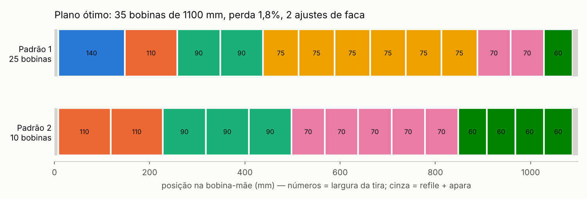
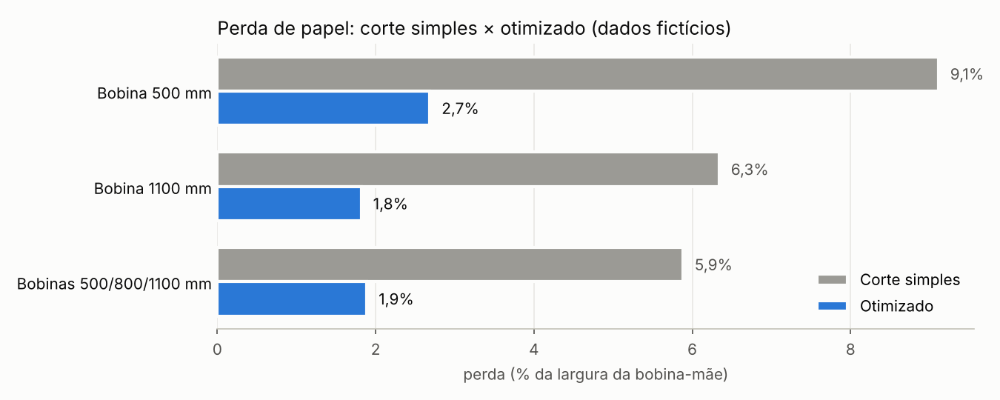

# Otimizador de Corte para Rebobinadeira

[](https://github.com/Mazeik/otimizador-corte-rebobinadeira/actions/workflows/testes.yml)


Ferramenta em Python que calcula **a melhor forma de cortar bobinas-mãe de papel** numa rebobinadeira de facas, atendendo os pedidos dos clientes com **a menor apara (perda) possível** e poucos ajustes de faca.

## Em resumo

| | |
|---|---|
| **Problema** | Cortar cada bobina-mãe numa largura só gera de 6% a 9% de apara. Combinar larguras reduz a perda, mas são milhares de combinações possíveis. |
| **Solução** | Geração de todos os padrões de corte viáveis + **Programação Linear Inteira** (solver HiGHS, via SciPy) para escolher quantas bobinas cortar com cada padrão. |
| **Resultado (dados fictícios)** | Perda de **6,3% → 1,8%**, 2 bobinas-mãe a menos no lote de exemplo, com **apenas 2 ajustes de faca**. Num mês simulado: 18 bobinas e ≈ 9,5 t de papel economizadas. |
| **Saída** | Plano pronto para o operador: largura da bobina, posição de cada faca em mm, e CSV que abre no Excel. |
| **Ferramentas** | Python, NumPy, SciPy (`milp`/HiGHS), pandas, matplotlib, pytest, GitHub Actions |



## Contexto

O projeto nasceu de um problema real de chão de fábrica: a rebobinadeira cortava cada bobina-mãe numa largura só e a apara pesava no consumo de papel, a principal matéria-prima. Este repositório reproduz o método com **dados 100% fictícios**, sem nenhuma informação da empresa.

## O problema

Na rebobinadeira, a bobina-mãe chega com uma largura que **varia de 500 a 1100 mm** e é cortada por **17 facas** em bobinas-filhas nas larguras que os clientes pedem. As bordas levam um **refile**, cujo tamanho depende do ajuste das facas.

Se o cliente pede **75 mm** e uma bobina de 500 mm é cortada só nessa largura:

```
6 × 75 mm = 450 mm   →   50 mm de apara em TODA bobina (10% de perda)
```

Quando chegam vários pedidos (70, 75, 90, 110 mm...), dá para **combinar larguras diferentes na mesma bobina** e aproveitar essa sobra. Só que o número de combinações é enorme: numa bobina de 1100 mm, com 6 larguras e até 16 tiras, são mais de 4.500 combinações possíveis. Escolher na mão quais usar, e quantas vezes cada uma, é inviável. Esse é o clássico **Problema de Corte Unidimensional** (*Cutting Stock Problem*).

## O método

1. **Geração de padrões** ([padroes.py](otimizador_corte/padroes.py)): para cada largura de bobina-mãe disponível, listamos todas as formas viáveis de posicionar as facas, respeitando:
   - soma das larguras ≤ largura da bobina − 2 × refile mínimo;
   - nº de tiras ≤ nº de facas − 1 (com 17 facas, até 16 tiras).
2. **Otimização** ([otimizador.py](otimizador_corte/otimizador.py)): um modelo de **Programação Linear Inteira** decide quantas bobinas-mãe cortar com cada padrão:

   ```
   minimizar    Σ W_p · x_p  +  custo_troca · W_max · Σ y_p
   sujeito a    Σ_p a_ip · x_p ≥ demanda_i      (todo pedido é atendido)
                x_p ≤ M · y_p                     (y_p = padrão p foi usado)
                x_p inteiro ≥ 0,  y_p ∈ {0,1}
   ```

   - `x_p`: quantas bobinas cortar com o padrão `p`
   - `W_p`: largura da bobina-mãe do padrão (minimizar `Σ W_p·x_p` = gastar menos papel)
   - `a_ip`: quantas tiras da largura `i` o padrão `p` gera
   - `custo_troca` (opcional): penaliza cada padrão diferente, porque trocar as facas toma tempo de máquina. É medido em "bobinas da maior largura".

   O modelo é resolvido com o solver **HiGHS**, que já vem no SciPy (`scipy.optimize.milp`). Com custo de troca, o problema fica bem mais pesado. Por isso ele é resolvido em duas etapas: primeiro só o papel, depois as trocas, considerando só os ~400 padrões mais promissores (escolhidos pelo *custo reduzido* da relaxação linear).
3. **Comparação** com o *corte simples* (uma largura por bobina), para medir o ganho.

## Resultados (dados fictícios)

Pedidos de [dados/pedidos_exemplo.csv](dados/pedidos_exemplo.csv): 25 × 140 mm, 45 × 110 mm, 80 × 90 mm, 150 × 75 mm, 90 × 70 mm e 60 × 60 mm.



| Cenário | Corte simples | Otimizado | Ajustes de faca |
|---|---|---|---:|
| Bobina 500 mm, refile 5 mm | 83 bobinas, perda 9,11% | **76 bobinas, perda 2,68%** | não otimizado |
| Bobina 1100 mm, refile 8 mm | 37 bobinas, perda 6,34% | **35 bobinas, perda 1,82%** | não otimizado |
| Bobina 1100 mm, refile 8 mm, `custo_troca = 1` | 37 bobinas, perda 6,34% | **35 bobinas, perda 1,82%** | **2** |
| Bobinas de 500, 800 e 1100 mm, refile 8 mm | 39.800 mm de papel, perda 5,88% | **37.600 mm de papel, perda 1,89%** | não otimizado |

Sem `custo_troca`, o modelo só minimiza papel e não se importa com quantos padrões usa (de 9 a 15 nesses exemplos). Com `custo_troca = 1`, o **mesmo consumo de papel** sai com **2 ajustes de faca**:

```
 Padrão 1: cortar 25 bobina(s) de 1100 mm
   Tiras:  1 x 140 + 1 x 110 + 2 x 90 + 6 x 75 + 2 x 70 + 1 x 60  (13 tiras)
   Apara:  20 mm por bobina (refile + sobra)
   Facas (14) em mm: [8, 148, 258, 348, 438, 513, 588, 663, 738, 813, 888, 958, 1028, 1088]

 Padrão 2: cortar 10 bobina(s) de 1100 mm
   Tiras:  2 x 110 + 3 x 90 + 5 x 70 + 4 x 60  (14 tiras)
   Apara:  20 mm por bobina (refile + sobra)
   Facas (15) em mm: [8, 118, 228, 318, 408, 498, 568, 638, 708, 778, 848, 908, 968, 1028, 1088]
```

> **Sobre reprodutibilidade:** o consumo de papel e a perda são sempre os mesmos. Já o plano exato pode mudar, porque costuma haver mais de um plano ótimo. Com `custo_troca`, use `--tempo-limite 120`: com o limite padrão (30 s), o solver para antes de provar o ótimo e pode entregar 3 ou 4 ajustes em vez de 2. O próprio relatório avisa quando isso acontece.

### Cenário hipotético: um mês de produção

Simulando 4 semanas de pedidos fictícios numa bobina de 1100 mm, o otimizador economizaria **18 bobinas-mãe no mês (≈ 9.500 kg de papel, ≈ R$ 57 mil)**, reduzindo a perda de 6–9% para cerca de 2%, com 3 ou 4 ajustes de faca por semana. Detalhes e premissas em [docs/cenario_hipotetico.md](docs/cenario_hipotetico.md).

## Como usar

```bash
pip install -r requirements.txt

# uma largura de bobina-mãe
python main.py dados/pedidos_exemplo.csv --largura 1100 --refile 8

# várias larguras disponíveis: o programa escolhe a melhor para cada padrão
python main.py dados/pedidos_exemplo.csv --largura 500 800 1100 --refile 8

# preferindo menos trocas de faca e salvando o plano para o Excel
python main.py dados/pedidos_exemplo.csv --largura 1100 --refile 8 --custo-troca 1 --tempo-limite 120 --csv-saida plano.csv
```

Opções:

| Opção | Significado | Padrão |
|---|---|---|
| `--largura` | largura(s) da bobina-mãe em mm (uma ou várias) | 500 |
| `--facas` | número de facas da máquina | 17 |
| `--refile` | refile **mínimo** em cada borda (mm); se sobrar mais, vira apara | 0 |
| `--custo-troca` | penalidade por padrão diferente, em bobinas | 0 |
| `--excedente-max` | excedente máximo por item (0.1 = 10%) | sem limite |
| `--tempo-limite` | tempo máximo do solver, em segundos | 30 |
| `--csv-saida` | salva o plano de corte em CSV (separador `;`, abre no Excel) | não salva |

O CSV de pedidos tem as colunas `cliente,largura_mm,quantidade` (ver [dados/pedidos_exemplo.csv](dados/pedidos_exemplo.csv)). Também aceita `;` como separador, que é o formato do Excel em português. Se alguma linha tiver valor inválido, o programa diz qual linha corrigir.

Também dá para usar direto no Python:

```python
from otimizador_corte import Configuracao, Pedido, otimizar, formatar_resultado

cfg = Configuracao(largura_bobina_mm=[500, 800, 1100], facas=17, refile_mm=8)
res = otimizar([Pedido(75, 120), Pedido(70, 90), Pedido(110, 45)], cfg)
print(formatar_resultado(res, cfg))
```

## Demonstração

O notebook [notebooks/demonstracao.ipynb](notebooks/demonstracao.ipynb) mostra o passo a passo, com gráfico dos padrões de corte, o caso com várias larguras de bobina-mãe e o efeito do custo de troca de facas.

## Estrutura

```
├── otimizador_corte/
│   ├── padroes.py       # geração dos padrões de corte
│   ├── otimizador.py    # modelo de otimização e comparação
│   └── relatorio.py     # leitura/gravação de CSV e relatório para o operador
├── dados/
│   └── pedidos_exemplo.csv   # pedidos fictícios
├── docs/
│   ├── cenario_hipotetico.md # um mês de produção simulado
│   └── img/                  # figuras do README
├── exemplos/
│   ├── cenario_hipotetico.py # script que gera o cenário
│   └── gerar_figuras.py      # script que gera as figuras
├── notebooks/
│   └── demonstracao.ipynb
├── tests/
│   └── test_otimizador.py
├── main.py              # linha de comando
└── requirements.txt
```

Para rodar os testes: `python -m pytest` (também rodam automaticamente no GitHub a cada envio).

## Limitações e próximos passos

- Considera só a **largura**; não trata comprimento/diâmetro das bobinas-filhas nem emendas.
- Não limita quantas bobinas-mãe de cada largura existem em estoque.
- Bobinas-filhas excedentes (quando o padrão produz um pouco além do pedido) contam como produto, não como perda. Na prática, precisam ter saída.
- Em casos grandes (várias larguras de bobina-mãe, custo de troca), o solver para no tempo limite e informa **quão longe do ótimo** a solução pode estar. O próximo passo seria usar **geração de colunas** (Gilmore-Gomory).
- Possíveis extensões: prioridade e prazo por cliente, estoque de bobinas-mãe, interface web.

## English summary

Python tool for the **one-dimensional cutting stock problem** on a paper slitter-rewinder (17 knives, parent rolls of 500–1100 mm). It enumerates feasible knife patterns and solves an **integer linear program** with SciPy's HiGHS solver, optionally penalizing knife changes. On the (fictitious) sample orders, trim loss drops from 6.3% to 1.8% with only 2 knife setups. All data in this repository is fictitious.

## Autor

**John Wesley da Silva**, Engenheiro de Produção (processos, qualidade, PCP e logística).
[LinkedIn](https://www.linkedin.com/in/john-wesley-da-silva/)

## Aviso

Todos os dados deste repositório são **fictícios** e servem apenas para demonstração.

## Licença

[MIT](LICENSE)
